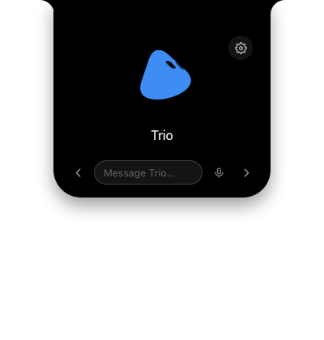
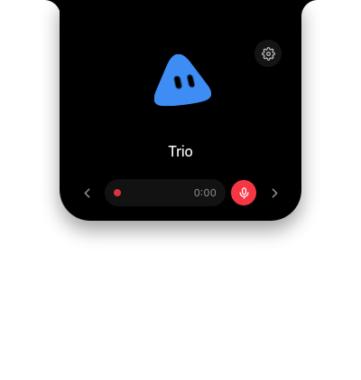
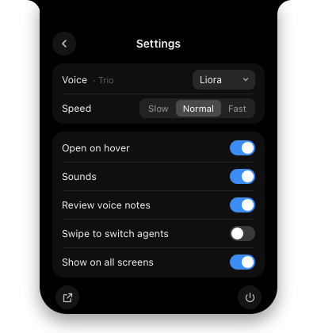

<div align="center">

# ✦ GrokBot Notch

**Talk to your Grok Bots from your Mac's notch.** Realtime voice calls, voice notes and quick chat, with your session kept on your Mac.

[](#requirements)
[](#requirements)
[](macos/NotchApp.swift)
[](scripts/build-mac-app.sh)
[](package.json)
[](SECURITY.md)
[](LICENSE)
[](https://github.com/robzilla1738/grokbot-notch)



</div>

---

## About this fork

This is a security-hardened, extended fork of [**robzilla1738/grokbot-notch**](https://github.com/robzilla1738/grokbot-notch) by Robert Courson. Credit for the original idea, the notch UI and the Motion Lab characters goes to him.

The original runs a local server on `127.0.0.1:4789` with CORS `*` that forwards your Grok Bot session token, which any website you visit could reach. This fork removes that server entirely. See [SECURITY.md](SECURITY.md) and the [changelog](CHANGELOG.md).

## Screenshots

| Ready | Recording a voice note | Settings |
| :---: | :---: | :---: |
|  |  |  |

## Features

- **Voice calls** with any of your bots over xAI Realtime, with echo cancellation, barge-in and mute.
- **Voice notes**: hold Space, talk, release to send. You can turn on review to listen, discard or re-record first. Transcribed on-device.
- **Chat**: start typing and press Enter.
- **Lives in the notch** on every screen, at menu-bar height, with your agent's photo and a live waveform.
- **Hover to peek**, click outside to close. Unsent drafts keep it open.
- **Settings inside the notch**: voice, speed, sounds, hover, swipe, review voice notes, all screens. Open Grok Bot and Quit are there too, so there's no menu-bar icon.

## Install

Requires [Desktop Grok Bot](#requirements), signed in.

```bash
git clone https://github.com/brahimhamichan/grokbot-notch.git ~/grokbot-notch
cd ~/grokbot-notch
npm run install:app
```

This builds `GrokBot Notch.app`, installs it in `/Applications` and launches it. On first run macOS asks for **Keychain** access (choose *Always Allow*), and later for **Microphone** and **Speech Recognition**.

Prefer to let your Grok Bot do it? See [GROKBOT_SETUP.md](GROKBOT_SETUP.md).

## Shortcuts

| Action | Shortcut |
| :--- | :--- |
| Open / close the notch | `⌥Space`, click, or hover |
| Switch bot | `←` / `→` |
| Start / end a call | `Enter` (when not typing) or `⌘⇧G` |
| Mute during a call | `⌘⇧M` |
| Voice note | Hold `Space`, or tap the mic |
| Type a message | Just start typing, then `Enter` |
| Settings | `⌘,` or the gear |
| Close | `Esc` or click outside |

## How it works

```text
┌────────────── GrokBot Notch.app ──────────────┐
│  WKWebView (gbnotch://, strict CSP)           │
│        ▲  postMessage                          │
│  Swift: panels, hotkeys, audio, Keychain       │
│        ▲  stdin / stdout (JSON lines)          │
│  Bundled Node bridge (server.mjs)              │
└────────┬──────────────────────────┬───────────┘
         ▼                          ▼
  https://api2.cursor.sh     wss://api.x.ai (voice)
```

| Path | What it is |
| :--- | :--- |
| `macos/NotchApp.swift` | Native app: panels, scheme handler, bridge, audio, voice notes, hotkeys |
| `server.mjs` | Zero-dependency bridge to Grok Bot's ConnectRPC API |
| `public/` | Notch UI and Motion Lab character engine |
| `scripts/` | Setup, build and launch |

## Requirements

- macOS 13+ on Apple Silicon. The bundled Node.js is arm64.
- Desktop Grok Bot installed at `/Applications/Grok Bot.app` and signed in.
- Xcode Command Line Tools (`xcode-select --install`).

## Contributing

See [CONTRIBUTING.md](CONTRIBUTING.md). Report security issues privately per [SECURITY.md](SECURITY.md).

## Disclaimer

An unofficial community project. It is not affiliated with or endorsed by xAI, Grok or Cursor. It uses your own local Grok Bot session.

## License

[MIT](LICENSE). Original work © Robert Courson, fork changes © Brahim Hamichan.
